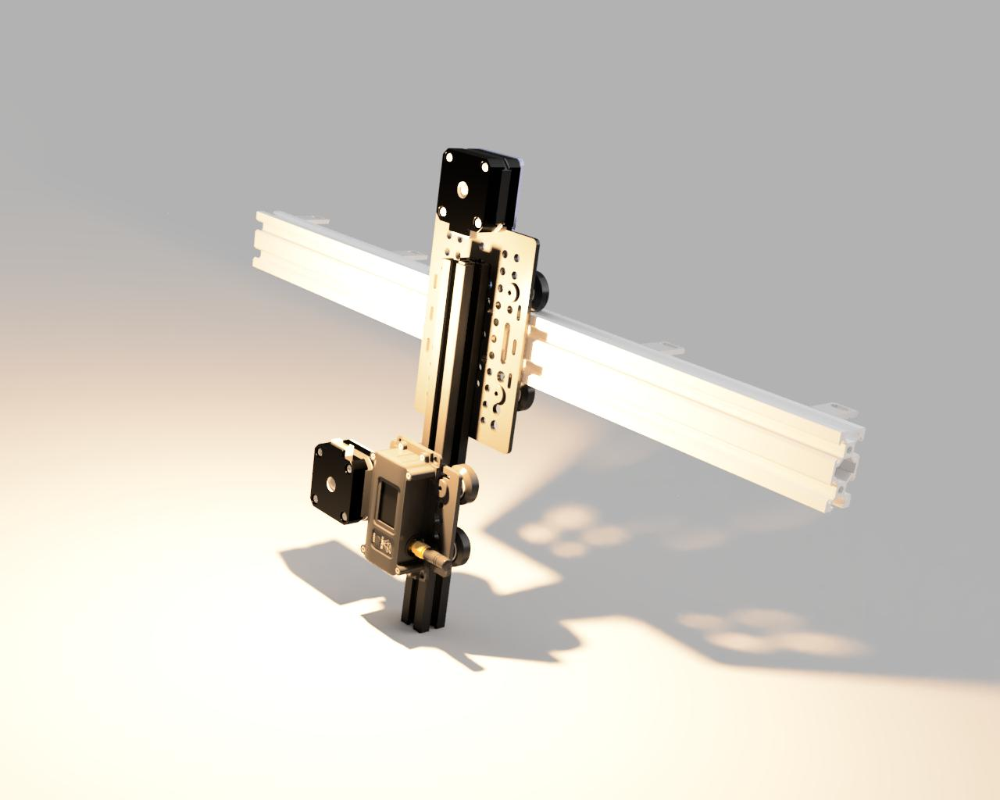
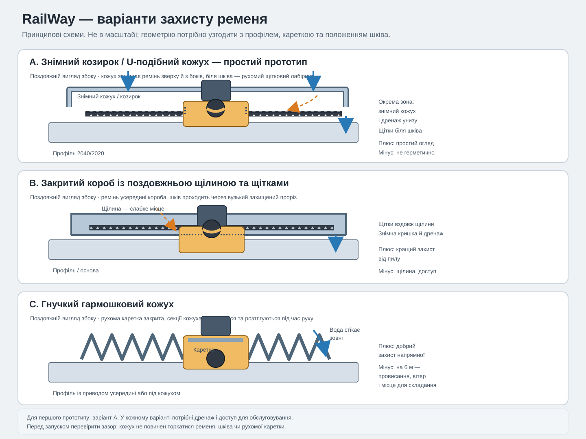

# RailWay — нотатки щодо проєкту третьої плати

## Короткий опис проєкту

RailWay — робоча назва окремої третьої плати-контролера для двокоординатної
рейкової конструкції, яка переміщуватиме один радіодатчик.

- Горизонтальний хід: приблизно 6 м.
- Вертикальний хід: приблизно 2 м.
- Двигуни: по одному кроковому двигуну на кожну вісь.
- Напрямні: стандартні каретки OpenBuilds для профілів 2040 і 2020.
- Привід кожної каретки: двигун встановлений на каретці та обертає шків на
  20 зубців, який входить у зачеплення із зубчастим ременем шириною 6 мм.
  Ремінь натягнутий і закріплений на протилежних кінцях відповідного профілю;
  каретка рухається вздовж нерухомого ременя завдяки обертанню шківа.
- Горизонтальна вісь: два кінцевики, по одному на кожному кінці ходу.
- Вертикальна вісь: один кінцевик.
- Плата керування: Makerbase MKS-DLC32, фактична ревізія на платі — V2.2.
  Для V2.2 виробник не опублікував апаратних файлів, тому за базу взято V2.1
  (див. розділ «Дослідження плати та прошивки»).
- RailWay — незалежний пристрій. Він не повинен залежати від BLE або
  обмінюватися даними через BLE із платами поворотного чи нахильного столів.

Наведені розміри описують запланований механізм. Межі переміщення у прошивці
мають налаштовуватися та калібруватися відповідно до фактично встановленого
механізму.

## Попередня візуалізація конструкції

Зображення нижче — приблизна візуалізація двокоординатного механізму, а не
остаточне креслення чи схема підключення. На ньому вертикальна напрямна з
кареткою закріплена на горизонтальній каретці; вузол радіодатчика розташований
на вертикальній каретці. Точне розташування двигунів, ременів, кінцевиків і
датчика потрібно підтвердити за фактичною конструкцією.

## Попередні ідеї захисту ременів

Оскільки шків двигуна має безпосередньо входити в зачеплення з нерухомим
зубчастим ременем, повністю закрити ремінь звичайним кожухом не можна:
потрібен вільний доступ шківа до зубців. Захист має відводити воду та
обмежувати потрапляння пилу, не створюючи перешкод для каретки й не утримуючи
вологу всередині.

Схематичне порівняння трьох варіантів:

### Варіант для початкового прототипу

- Розмістити ремінь на захищеному боці профілю — під полицею або всередині
  додаткового U-подібного/коробчастого кожуха, якщо це дозволяє розташування
  каретки та шківа.
- Закрити задній і бічні боки ременя знімною кришкою; залишити на боці шківа
  лише необхідний для зачеплення прохід.
- Встановити на каретці невеликий кожух із щітковими ущільнювачами або
  лабіринтним перекриттям навколо місця проходу шківа. Це зменшить пряме
  потрапляння пилу та бризок, але не буде герметичним ущільненням.
- Розташувати отвори для стоку вологи в найнижчих точках. Не робити довгий
  герметичний канал без дренажу та можливості просушування: конденсат усередині
  може бути шкідливішим за випадкові бризки.
- Передбачити знімні секції кришки для огляду, очищення, перевірки натягу та
  заміни ременя.

Для вертикальної осі особливо важливо розмістити ремінь і його кожух так, щоб
вода з верхньої частини конструкції не стікала всередину. Кромка або козирок
зверху та дренаж унизу можуть допомогти відвести воду. Двигун, роз'єми й
електроніку слід захищати окремими корпусами, підібраними за реальними умовами
експлуатації; захист ременя сам по собі не забезпечує захист електрики.

### Альтернативи та обмеження

- **Відкрите розміщення під профілем із простим козирком:** недороге та зручне
  для огляду, захищає від прямого дощу, але слабко захищає від дрібного пилу,
  бризок і бруду, що летить знизу.
- **Гнучкий гармошковий кожух:** може добре ізолювати напрямну, але на ході
  близько 6 м буде громіздким, потребуватиме місця для складання та перевірки
  стійкості до вітру, провисання й накопичення води. Він також не повинен
  заважати рухомому двигуну або натягу ременя.
- **Щільний короб із поздовжньою щілиною:** краще обмежує пил, але щілина,
  необхідна для проходу приводу, все одно лишається шляхом для забруднень.
  Потрібні знімний сервісний доступ, дренаж і перевірка, що кожух не торкається
  зубців ременя чи шківа.

Для першої версії доцільно почати зі знімного U-подібного кожуха з козирком,
дренажем і рухомим щітковим/лабіринтним захистом біля шківа. Остаточну форму
потрібно визначити за перерізом профілю, положенням ременя та напрямком
зачеплення шківа; наведена ідея ще не є готовим кресленням.

Не варто наносити мастило на зубчастий ремінь без прямої рекомендації його
виробника: мастило може притягувати абразивний пил або пошкоджувати матеріал
ременя. Потрібно також уточнити матеріал ременя та корду, сумісність із
вологістю/ультрафіолетом і температурою, а також профіль зубців, що відповідає
шківу.

## Дослідження плати та прошивки

Репозиторій MKS-DLC32 містить документацію плати, файли апаратних ревізій і
готові образи прошивки. Вихідний код прошивки Grbl_ESP32 зберігається в окремому
репозиторії.

- Репозиторій апаратної частини та документації:
  <https://github.com/makerbase-mks/MKS-DLC32>
- Репозиторій вихідного коду прошивки:
  <https://github.com/makerbase-mks/MKS-DLC32-FIRMWARE>
- Профіль контактів DLC32 (`USE_BOARD_V2_0`), який використовується як орієнтир
  для V2.1/V2.2:
  <https://github.com/makerbase-mks/MKS-DLC32-FIRMWARE/blob/main/Firmware/Grbl_Esp32/src/Machines/i2s_out_xyz_mks_dlc32.h>
- Перелік апаратних ревізій і примітки щодо них:
  <https://github.com/makerbase-mks/MKS-DLC32/blob/main/MKS-DLC32-main/hardware/README.md>
- Посібник із підключення:
  <https://github.com/makerbase-mks/MKS-DLC32/blob/main/MKS-DLC32-main/doc/DLC32%20wiring%20manual.pdf>

У згаданому профілі контактів прошивки вибрано `USE_BOARD_V2_0`. Сигнали STEP і
DIR формуються через вихід I2S плати, а не безпосередньо GPIO ESP32. Цей профіль
є лише орієнтиром; перед підключенням потрібно перевірити маркування плати,
позначення роз'ємів, схему та посібник із підключення.

### Ревізія V2.2

- Фактична ревізія отриманої плати — V2.2. У репозиторії виробника є файли лише
  для V1.1, V2.0 і трьох варіантів V2.1 (`_001`–`_003`); для V2.2 їх немає.
  Запит на додавання файлів V2.2 відкритий без відповіді:
  <https://github.com/makerbase-mks/MKS-DLC32/issues/600>
- Рішення: як базову схему й розпайку використовуємо V2.1. Це припущення, що
  між V2.1 і V2.2 немає змін у схемі; виробник його не підтверджував. Можливі
  заміни компонентів без зміни функціональності.
- За журналом змін виробника від V2.0 до V2.1 змінювалися лише монтажні
  отвори, покриття плати (чорне занурене золото), напрямок фіксатора J18
  (порядок ліній без змін) та шовкографія. Електричних змін V2.0 → V2.1 у
  журналі немає, тому профіль V2.0 застосовний до V2.1 і, імовірно, до V2.2.
- Ревізію підтверджено фото ([лицьова сторона](./mks/20261030_202911.jpg),
  [зворотна](./mks/20261102_101134.jpg)): шовкографія «Makerbase MKS DLC32 V2.2».
  На платі три слоти драйверів X/Y/Z із червоними 3-позиційними DIP-перемикачами
  мікрокроку, плоский запобіжник у рознімному гнізді, місце під вимикач
  («SWITCH»), вхід «POWER 12–24V», модуль ESP32-WROOM-32U із зовнішньою антеною,
  роз'єми I2C (SCL/SDA/G/3V3) і Probe. Усе це збігається з профілем V2.0/V2.1.
- Драйвери: MKS TMC2209 V2.0 (зараз не встановлені). За даними продавців:
  струм за замовчуванням 1,25 А, максимум 2,5 А, живлення двигуна до 28 В,
  мікрокрок до 1/256, інтерфейс UART, StealthChop2/SpreadCycle, форм-фактор
  StepStick. Спосіб керування (лише STEP/DIR із DIP-перемикачами чи також UART) на
  DLC32 потрібно підтвердити за схемою V2.1 та документацією драйвера. Значення
  мікрокроку, яке задають DIP-перемикачі, має збігатися з налаштуваннями кроків
  на міліметр у прошивці.
- Антенний кабель на фото проходить поперек плати над силовими елементами; його
  слід прокласти осторонь драйверів і запобіжника. На зворотній стороні біля
  нижніх контактів видно забруднення (ймовірно, флюс) — перед використанням
  очистити.
- Перед підключенням двигунів і кінцевиків звірити фізичну плату зі схемою V2.1:
  маркування роз'ємів і слотів драйверів, перемикачі мікрокроку, тип драйверів
  і запобіжника. Розбіжності записати в цей документ.

## Попередня таблиця контактів і роз'ємів

Наведене нижче зіставлення взято з офіційного профілю
`i2s_out_xyz_mks_dlc32.h`. Воно відповідає V2.0/V2.1; для V2.2 його потрібно
звірити з фактичною платою перед підключенням.

Використовуються осі **X** (горизонтальна) і **Z** (вертикальна); слот і вихід Y
не використовуються.

| Функція RailWay | Функція DLC32 | Сигнал у профілі |
|---|---|---|
| STEP горизонтального двигуна | Драйвер X | `I2SO(1)` |
| DIR горизонтального двигуна | Драйвер X | `I2SO(2)` |
| STEP вертикального двигуна | Драйвер Z | `I2SO(3)` |
| DIR вертикального двигуна | Драйвер Z | `I2SO(4)` |
| Вимкнення/увімкнення драйверів | Драйвери X/Z | `I2SO(0)` (спільний для X, Y і Z) |
| Горизонтальний кінцевик з одного боку | X LIMIT | GPIO ESP32 36 |
| Горизонтальний кінцевик з іншого боку | Y LIMIT (вхід вільної осі) | GPIO ESP32 35 |
| Вертикальний кінцевик | Z LIMIT | GPIO ESP32 34 |

Важливі примітки:

- Вихід Z у профілі DLC32 увімкнено визначенням `USR_Z_MOTOR`; без нього Z-пін
  не задаються. У власній прошивці RailWay це не потрібно, але слід підтвердити,
  що I2S-виходи Z (`I2SO(3)`, `I2SO(4)`) відповідають слоту Z на платі.
- Сигнал вимкнення/увімкнення драйверів спільний для всіх осей. Потрібно
  перевірити, як він працюватиме з вибраними драйверами; не слід вважати, що
  двигуни можна вмикати незалежно.
- GPIO34, GPIO35 і GPIO36 призначені лише для входу й не мають внутрішніх
  підтягувальних резисторів. Тип електричного кола кінцевика та потребу в
  зовнішньому підтягувальному резисторі потрібно перевірити за схемою,
  посібником і способом підключення конкретного вимикача.
- Назви кінцевиків у таблиці — логічні назви роз'ємів/профілю. Під час
  налагодження механізму потрібно визначити, до якого з фізичних кінців
  горизонтальної осі підключити X LIMIT і Y LIMIT, а також який із них буде
  використовуватись для homing. Вхід Y LIMIT тут лише логічно вільний (вісь Y не
  використовується), тому його можна призначити другому горизонтальному
  кінцевику.
- У профілі також призначено GPIO16, GPIO17 і GPIO21 для сигналів виходу I2S.
  Не використовуйте ці GPIO для інших функцій без перевірки схеми плати та
  периферійних модулів прошивки.

## Наявні підходи в проєкті

Наразі репозиторій збирає дві прошивки в межах одного проєкту PlatformIO:

- `rotating_table`: Wi-Fi вебсервер/API, керування рухом і BLE-клієнт.
- `tilt_platform`: окремий контролер руху та BLE-сервер.

Для RailWay корисно використати наявні підходи до конфігурації та контролерів:
окреме середовище PlatformIO, ізольовану точку входу й фільтр вихідних файлів,
налаштування в NVS, телеметрію стану, аварійну зупинку, homing і вебінтерфейс/API.
RailWay має бути окремою ціллю збірки та не повинен містити функцій BLE-клієнта
чи BLE-сервера.

У наявних контролерах крокових двигунів використовується AccelStepper і завдання
FreeRTOS. У профілі DLC32 виходи STEP/DIR на роз'ємах драйверів формуються через
I2S, тому не можна вважати, що звичайне формування імпульсів через GPIO ESP32
керуватиме вбудованими роз'ємами драйверів. Перед реалізацією потрібно вибрати
та перевірити відповідний спосіб формування крокових імпульсів для цієї плати.
Планувальник і генератор кроків Grbl_ESP32 можна використовувати як архітектурні
орієнтири; повністю переносити їхній код необов'язково.

## Запропонований обсяг прошивки

Початкова прошивка RailWay має забезпечувати:

1. Незалежний рух по X (горизонталь) та Z (вертикаль), а також узгоджене
   переміщення до цільових координат X/Z.
2. Координати в міліметрах і налаштовувану кількість кроків на міліметр.
   Для описаного прямого ремінного приводу початковий розрахунок:
   `кроків/мм = (кроків двигуна на оберт × мікрокрок) / (20 зубців × крок зубців ременя в мм)`.
   Розрахунок передбачає безпосереднє зачеплення шківа з нерухомим ременем без
   додаткового передатного механізму; його потрібно перевірити на фактичній
   конструкції.
3. Налаштовувані межі переміщення, початково орієнтовані на механізм приблизно
   6000 мм по горизонталі та 2000 мм по вертикалі.
4. Homing: використання обох горизонтальних кінцевиків для визначення діапазону
   горизонтального переміщення та вертикального кінцевика для визначення
   початкової точки вертикальної осі. Під час реалізації потрібно визначити
   напрямок пошуку, швидкий пошук, відхід від кінцевика та повільний повторний
   підхід.
5. Програмні обмеження після успішного homing, зупинку з урахуванням
   спрацювання кінцевиків, аварійну зупинку та зрозуміле повідомлення про
   помилки.
6. Окремий інтерфейс Wi-Fi/веб/API, якщо такий спосіб керування буде обрано.
   Зв'язок між платами через BLE не потрібен.
7. Телеметрію, яка відрізняє задану позицію/позицію за лічильником кроків від
   незалежно виміряної фізичної позиції. Лічильник кроків не виявляє пропущених
   кроків або механічного люфту.
8. Симулятор і збірку нової прошивки в CI та релізах.

## Безпека та налагодження механізму

- Вертикальна каретка може впасти або зміститися під дією сили тяжіння, якщо
  двигун втратить утримувальний момент. Перед покладанням на прошивку потрібно
  передбачити та перевірити належний механічний захист, наприклад гальмо,
  противагу або самогальмівну передачу.
- Один вертикальний кінцевик задає лише одну межу. Для протилежної межі потрібне
  перевірене програмне обмеження; слід також розглянути додатковий фізичний
  кінцевик або інший незалежний захист.
- Програмна аварійна зупинка не замінює належне фізичне коло аварійної зупинки
  або відключення живлення драйверів, якщо цього вимагає оцінювання ризиків
  механізму.
- До встановлення радіодатчика та його переміщення на повний хід перевірте на
  низькій швидкості напрямки руху двигунів, полярність кінцевиків, homing і
  поведінку зупинки.
- Не визначайте струм драйвера, розпайку двигуна, напругу живлення або
  сумісність рівнів сигналів кінцевиків лише за моделлю плати керування.
  Перевірте ці параметри для фактичних драйверів, двигунів, блока живлення та
  ревізії плати.

## Рішення та дані, які ще потрібно отримати

### Підтвердження апаратної частини

- Підтвердити, що V2.2 електрично збігається з V2.1 (фактична ревізія — V2.2,
  базова документація — V2.1): за фото плати, схемою V2.1 і перевіркою
  мультиметром.
- Фото або маркування плати, слотів драйверів і роз'ємів.
- Драйвери MKS TMC2209 V2.0 у слотах X і Z: підтвердити, чи керування
  лише STEP/DIR (мікрокрок DIP-перемикачами), чи також через UART; налаштувати
  струм відповідно до двигунів.
- Двигуни: NEMA 17, модель 17HS3401S (дані продавця): 1,8° (200 кроків/оберт),
  номінальний струм 1,3 А, опір фази 2,4 Ом, індуктивність 2,8 мГн, момент
  утримання 28 Н·см, корпус 42×42×34 мм, 4 проводи, вал 5 мм. Розпайку
  обмоток (пари A/B) перевірити мультиметром перед підключенням.
- Струм драйвера: номінал двигуна 1,3 А, типове значення драйвера за
  замовчуванням — 1,25 А. Починати з помірного значення, що не перевищує
  номінал, і підвищувати лише за потреби, контролюючи нагрів двигуна та
  драйвера. Спосіб встановлення струму (потенціометр/Vref чи UART) уточнити за
  документацією MKS TMC2209 V2.0.
- Мікрокрок на DIP-перемикачах: 1/16. Ремінь — GT2 (2GT, крок 2 мм, ширина 6 мм;
  аналог GATES Power Grip LL-2GT RF, за даними продавця), шків на 20 зубців:
  40 мм/оберт, отже 200 × 16 / 40 = **80 кроків/мм**. Значення слід перевірити
  вимірюванням на реальному ході й за потреби скоригувати (допуск шківа, ремінь,
  люфт).
- Крок і профіль зубців ременя, сумісність ременя зі шківом на 20 зубців, а
  також точна схема натягування та закріплення ременя на обох профілях.
- Умови експлуатації (приміщення/вулиця), види пилу та вологи, температурний
  діапазон і вимоги до частоти обслуговування ременів.
- Матеріал ременя й корду, стійкість до ультрафіолету та вологи, а також
  потрібний рівень захисту кожухів і електричних компонентів.
- Налаштування мікрокроку та перевірене значення кроків на міліметр для кожної
  осі.
- Тип кінцевиків (NO/NC), схема підключення, напруга/інтерфейс і фізичне
  розташування.
- Чи буде встановлено верхній кінцевик вертикальної осі або гальмо.
- Напруга/струм живлення та потрібна схема фізичної аварійної зупинки.

### Рішення щодо прошивки та роботи пристрою

- Чи має автономний інтерфейс використовувати Wi-Fi вебінтерфейс/API, команди
  через Serial або обидва варіанти.
- Чи потрібне RailWay оновлення OTA та як буде встановлено першу версію
  прошивки.
- Напрямки homing і безпечні швидкості пошуку для кожної осі.
- Початок системи координат і те, чи кінцевики горизонтальної осі задають весь
  робочий діапазон або він має містити запас безпеки.
- Максимальні швидкості, прискорення та допустима повторюваність позиціювання.
- Чи потрібні черга команд руху, шаблони сканування або інтеграція з керуванням
  радіодатчиком.

## План реалізації

1. Підтвердити, що V2.2 збігається зі схемою V2.1, та уточнити наведені вище
   питання щодо апаратної частини.
2. Підготувати остаточну таблицю/схему підключення за документацією та схемою
   відповідної ревізії; перевірити електричні рівні кінцевиків та інтерфейси
   драйверів. Окремо підтвердити крок зубців ременя, його профіль і зачеплення
   зі шківом на 20 зубців для обох осей, а також спроєктувати захист ременя з
   дренажем і доступом для обслуговування.
3. Створити прототип обраного способу формування крокових імпульсів на DLC32
   та окремо перевірити кожен двигун, напрямок, поведінку сигналу enable і
   входи кінцевиків.
4. Додати окреме середовище PlatformIO та точку входу RailWay, не змінюючи
   поведінку двох наявних цілей збірки.
5. Реалізувати перерахунок координат у міліметри, незалежний і узгоджений рух,
   налаштовувані межі, homing, зупинку та збереження конфігурації в NVS.
6. Додати автономний інтерфейс керування/стану, перевірки симулятора та
   публікацію результату збірки в CI/релізах.
7. Проводити перевірки поетапно: рух без навантаження на низькій швидкості,
   перевірка кінцевиків і homing, перевірка аварійної зупинки, а потім
   переміщення на повний хід із встановленим датчиком.

## Чернетка прошивки (середовище `railway`)

Збірка: `platformio run -e railway` (компілюється успішно; на плату **не завантажувалась**, на залізі не перевірялась).

- Файли: `src/main_railway.cpp`, `src/railway_controller.cpp`, `src/railway_web.cpp`, `include/railway_*.h`; Wi-Fi використовує спільний `wifi_manager` (хост `railway.local`, точка доступу `RailWay-ESP32`). BLE не використовується.
- STEP/DIR/EN виводяться програмно в регістри зсуву (BCK 16, WS 17, DATA 21, 32 біти, біт N = `I2SO(N)`) з таймера 20 кГц; EN активний низьким. Порядок бітів, polarity засувки та рівень EN **потрібно перевірити** на платі.
- Homing: спочатку X: швидкий пошук першого кінцевика → відкат → повільний захід → X=0, далі рух до другого кінцевика (Y LIMIT, GPIO35) з вимірюванням довжини (мінус відкат) і збереженням її в NVS. Потім Z вгору до верхнього кінцевика → Z=0. Висота Z задається вручну (за замовчуванням 500 мм) і обмежує хід униз. Поки довжину X не виміряно, пошук кінцевиків X ведеться на максимальний хід `RW_MAX_LENGTH_MM` (8000 мм), тож перший homing не залежить від значення довжини за замовчуванням; після вимірювання пошук першого кінцевика обмежено 1,2 × виміряної довжини. Спрацювання кінцевика не в напрямку homing зупиняє рух з помилкою.
- Налаштування (NVS): довжина X, висота Z від кінцевика, кроків/мм, інверсія DIR кожної осі, полярність кінцевиків, швидкість, прискорення, параметри homing, положення кінцевика Z (для карти).
- Веб-інтерфейс у стилі інших плат; клік по «стіні» (X × Z мм) відправляє каретку в точку, показуються координати курсора й цілі.
- API: `GET /api/status`, `POST /api/home|move|jog|stop|zero|enable`, `GET/POST /api/settings`, `/api/wifi/*`.
- OTA з GitHub: `railway.bin` з останнього релізу (`/api/ota/latest`, `/api/ota/update`), лише в режимі STA; CI збирає та публікує `railway.bin`.
- Веб-інтерфейс стіни: розміри в кутах, перехрестя-приціл за курсором.
- Не реалізовано: керування струмом/UART TMC2209 (струм задається апаратно), ремінні захисти (механіка).
## Симулятор веб-інтерфейсу

Запуск: `python railway_simulator.py` і відкрити http://127.0.0.1:8081/. Емулює API RailWay (homing з вимірюванням довжини X, рух, jog, налаштування, Wi-Fi, OTA); «фізична» рейка — 1200 мм.

